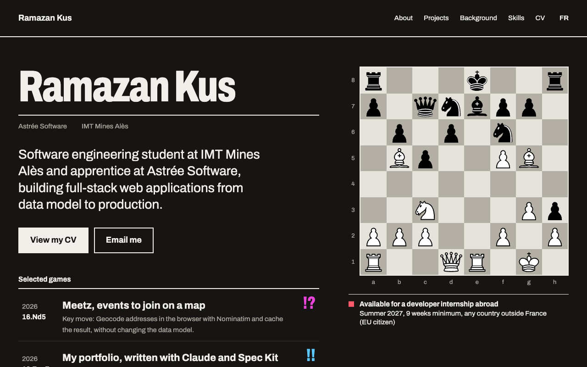

# Portfolio V2

[](https://github.com/ramazankus/portfolioV2/actions/workflows/ci.yml)

The source of my personal website. I'm a software engineering student at IMT Mines Alès,
currently building Java/Spring and Angular applications at Astrée Software.

Live at **[ramazankus.dev](https://ramazankus.dev)**, in French and in English. What is
left to build (a blog) is tracked in [`ROADMAP.md`](./ROADMAP.md).

[](https://ramazankus.dev/en/)

## How it's built

- **Static, zero client-side JavaScript by default.** Every page is generated at build time
  with [Astro](https://astro.build) and TypeScript in strict mode; there is no server.
- **Content is data.** Projects, experience and skills live as typed files in `src/content/`
  and `src/data/`. Adding a project means adding one Markdown file, not writing code.
- **Bilingual.** French by default, English under `/en`, with the same paths.
- **A CV built from the same data.** The `/cv` page and its PDF, compiled with LaTeX
  ([Tectonic](https://tectonic-typesetting.github.io)) at build time, never drift from the
  rest of the site.
- **Spec-driven.** Each feature starts as a spec, a plan and a task list written with
  [spec-kit](https://github.com/github/spec-kit), kept in [`specs/`](./specs).
- **A testbed for working well with AI.** I use this project to practise AI-assisted
  development with a coding agent, kept on a short leash: spec-kit turns each feature into a
  reviewed spec before any code exists, a [constitution](./.specify/memory/constitution.md)
  sets rules the agent cannot override, and every change goes through a draft PR that I
  review and merge myself.
- **Guarded by CI.** Every pull request and every push to `main` runs formatting, type checks
  (`astro check`), a production build and a check of every link in the built site.
- **The build is the test suite.** There is no runtime to test, so the content is checked
  when the site is built. A page missing in one language, a skill citing a project that does
  not exist or an invalid date fails the build with a message saying what to fix.
- **Kept simple.** KISS and YAGNI: nothing gets built "just in case".

## Architecture

```text
src/
├── content/   Markdown: project write-ups and long pages, one file per language
├── data/      typed constants and YAML (experience, skills, navigation), data only
├── lib/       reads and validates the data, the only layer views depend on
├── views/     one view per page, shared by the French and English routes
├── pages/     thin routes: a French file and its /en twin, both rendering the same view
├── components/, layouts/, styles/, i18n/
└── integrations/cv-pdf.ts   compiles the CV PDF after the build
```

A view never reads a collection or a file directly: it asks `src/lib/`. The full set of rules
is in the [constitution](./.specify/memory/constitution.md).

## Run it locally

Requires Node 22 (see [`.nvmrc`](./.nvmrc)) and, for the CV PDF,
[Tectonic](https://tectonic-typesetting.github.io) (`brew install tectonic`, or
`sh scripts/install-tectonic.sh`).

```sh
git clone git@github.com:ramazankus/portfolioV2.git
cd portfolioV2
npm install
npm run dev       # http://localhost:4321
npm run check     # formatting and types
npm run build     # static site and CV PDF in dist/
```

## Learn more

The project documents and the code comments are in French, my working language.

- [`CONTRIBUTING.md`](./CONTRIBUTING.md): commands, CI, workflow and conventions.
- [`CONTENU.md`](./CONTENU.md): goals, audiences and content model.
- [`PRODUCT.md`](./PRODUCT.md) and [`DESIGN.md`](./DESIGN.md): who the site is for and its
  visual direction.

## License

The code is under the [MIT license](./LICENSE). The content (texts, photo, CV, project
write-ups) is mine and all rights are reserved. The chess pieces and the font keep their
own licenses.
